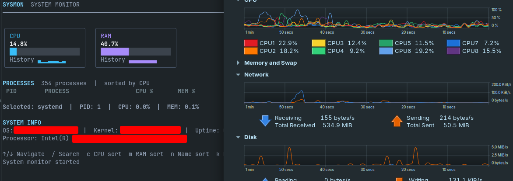

# sysmon-tui
   

A terminal system monitor built with [Bubble Tea](https://charm.land) and
[gopsutil](https://github.com/shirou/gopsutil).

Shows live CPU and RAM usage with history sparklines, a searchable/sortable
process list, system information, and process termination with confirmation.

## Requirements

- Go 1.26+

## Run

```sh
go run .
```

## Build

```sh
go build -o sysmon-tui .
```

## Keyboard shortcuts

| Key | Action |
| --- | --- |
| `↑`/`↓`, `PgUp`/`PgDn`, `Home`/`End` | Navigate processes |
| `/` | Search by name or PID (`Enter` finish, `Esc` clear) |
| `c` | Sort by CPU usage |
| `m` | Sort by memory usage |
| `n` | Sort by process name |
| `k` | Kill selected process (asks for `y` to confirm) |
| `q` / `Ctrl+C` | Quit |

Processes are never terminated automatically; PID 1 is always refused.

## Layout

```
main.go                     entry point
internal/monitor/           CPU/RAM metrics and history
internal/processes/         process collection, filtering, sorting, killing
internal/system/            OS, kernel, uptime and CPU info
internal/ui/                Bubble Tea model, update, view and styles
```
